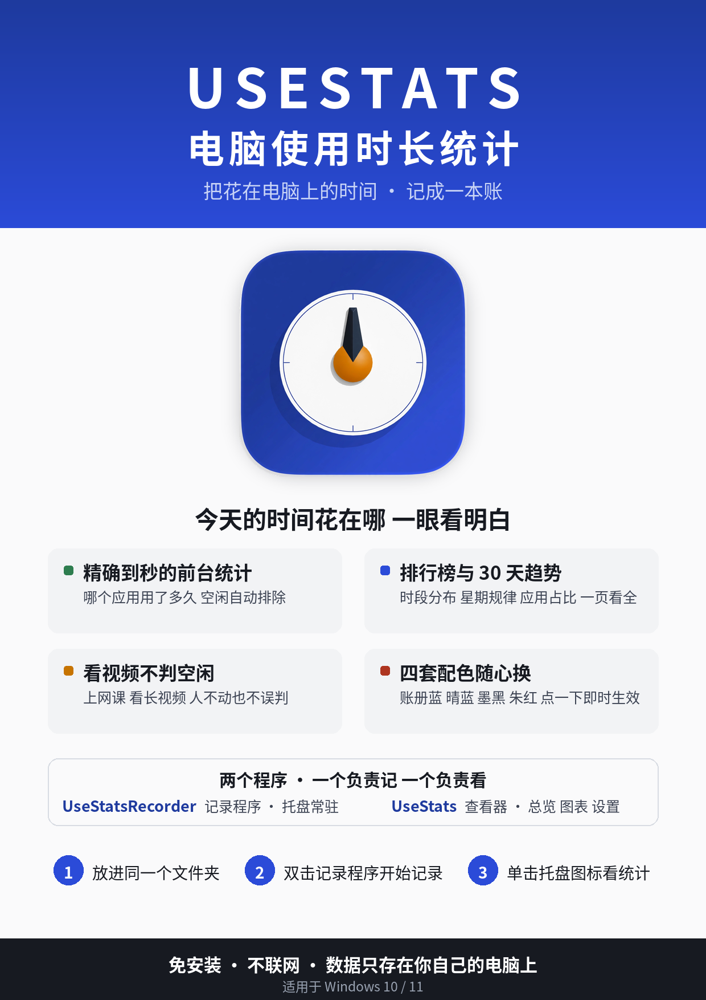

# UseStats · 电脑使用时长统计

把花在电脑上的时间，记成一本清楚的账：哪个应用用了多久、一天里什么时段最忙、最近一周是变忙还是变闲了，一眼看明白。

**免安装 · 不联网 · 数据只存在你自己的电脑上**



## 特性

- **精确到秒的前台统计**：每秒采样当前前台应用，键鼠空闲自动排除；另有后台运行统计作次要参考
- **看视频不判空闲**：前台应用正在出声或全屏播放时照常计时，上网课、看长视频不会被误判成离开；Edge / 哔哩哔哩的空闲阈值自动放宽
- **总览 + 图表**：今日 / 近 7 天 / 近 30 天切换、应用排行榜、24 小时分布、近 30 天趋势、星期规律、应用占比；数据不足时明确标注覆盖天数，不把「未记录」画成「零使用」
- **四套配色**：账册蓝 / 晴蓝 / 墨黑 / 朱红，字体内嵌在程序里，断网打开也完整显示
- **对普通用户友好**：系统进程显示中文友好名（WeChatAppEx → 微信小程序），排行榜可隐藏系统进程
- **记录可单独收纳**：exe 旁建一个 `record` 文件夹，使用记录与设置就自动存进去，主目录干干净净
- **小工具**：WiFi 断开时自动连接已保存的网络（可在设置里关掉）

## 快速开始

1. 从 [Releases](../../releases) 下载两个 exe（或按下方说明自行构建），放进同一个普通文件夹（不要放进 `C:\Program Files` 这类系统目录）。
2. 双击 **UseStatsRecorder.exe**：它会住进系统托盘开始记录，并自动打开一次查看器；之后每次开机自动启动。
3. 想看统计时，单击托盘图标，或双击 **UseStats.exe**。

详细说明（数据口径、设置项、注意事项、卸载）见 [docs/使用说明.md](docs/使用说明.md)。想先看看界面长什么样，可以直接用浏览器打开仓库里的 `usestats-demo.html`（内置虚构的示例数据）。

## 两个程序

| 程序 | 职责 |
|---|---|
| `UseStatsRecorder.exe` | 记录程序：托盘常驻、每秒采样前台应用、定时落盘；负责开机自启、托盘菜单与今日摘要 |
| `UseStats.exe` | 查看器：总览 / 图表 / 设置三页；纯查看不采集，关窗口只是收起，不影响记录 |

两个程序必须放在同一目录，共用同一份数据（`usage-YYYY-MM-DD.json` 与 `settings.json`，默认在 exe 旁，或 exe 旁的 `record` 文件夹里）。

## 构建

环境：MinGW-w64（`x86_64-w64-mingw32-g++`，在 Linux 上交叉编译或 Windows 上均可），C++17 + Win32 API，无第三方运行时依赖；WebView2 SDK 已放在 `third_party/` 里，查看器用的字体子集（Noto Sans SC 四个字重）已放在 `fonts/sub/` 里。

```bash
# 资源（图标、页面、字体、WebView2Loader）
x86_64-w64-mingw32-windres resources.rc  -O coff -o resources.o
x86_64-w64-mingw32-windres recorder.rc   -O coff -o recorder_resources.o

# 记录程序
x86_64-w64-mingw32-g++ -std=c++17 -Os -s -ffunction-sections -fdata-sections -Wl,--gc-sections \
  -mwindows -municode -static -Wall -Wextra -o UseStatsRecorder.exe \
  recorder.cpp tracker.cpp storage.cpp appinfo.cpp applog.cpp settings_io.cpp \
  autostart.cpp wifiassist.cpp mediawatch.cpp recorder_resources.o \
  -lversion -lshell32 -ladvapi32 -lole32 -luuid

# 查看器
x86_64-w64-mingw32-g++ -std=c++17 -Os -s -ffunction-sections -fdata-sections -Wl,--gc-sections \
  -mwindows -municode -static -Wall -Wextra \
  -I third_party/webview2/include -I third_party/webview2/compat -o UseStats.exe \
  viewer.cpp stats.cpp storage.cpp tracker.cpp appinfo.cpp applog.cpp settings_io.cpp \
  autostart.cpp mediawatch.cpp resources.o \
  -lversion -lshell32 -lole32 -lshlwapi -ladvapi32 -luuid
```

运行测试：

```bash
node tests/page_test.mjs     # 页面渲染与设置往返
node tests/contrast.mjs      # 四套主题对比度（WCAG AA）
python3 tests/recompute.py   # JS 聚合与 Python 独立复算对拍
```

## 数据与隐私

所有记录都是本地 JSON 文件，程序不联网、不上传、不注册账号；唯一的网络动作是可关闭的 WiFi 辅助（只自动连接系统里已保存的网络）。文件夹在你手里，数据就在你手里。

## 开发记录

这个项目是作者与 AI 结对迭代出来的：每一轮改动的原因、实现与真机验证结论都记在 [docs/开发记录.md](docs/开发记录.md) 里。

## License

[MIT](LICENSE)
